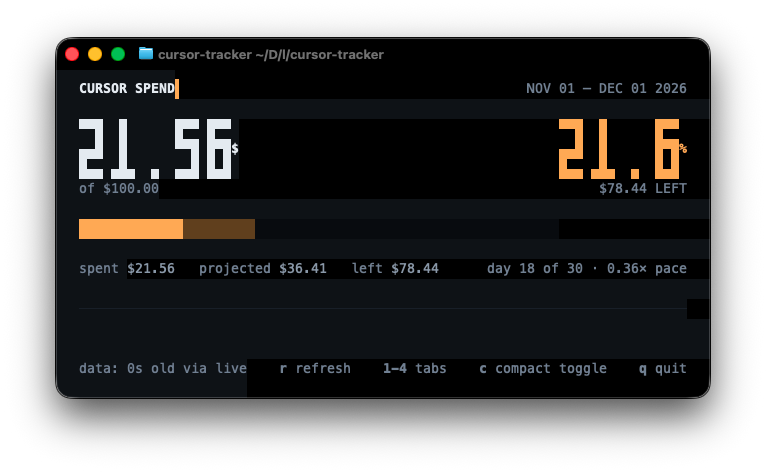
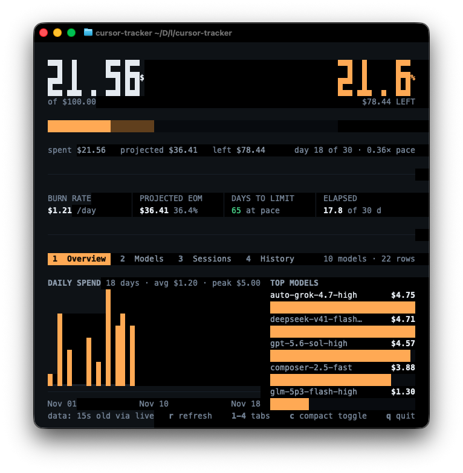

# cursor-tracker

Terminal dashboard for Cursor AI spend: month-to-date spend against your plan
limit, burn rate and end-of-month projection, per-model token/cost breakdown, and
OpenBot agent session activity. Built for the **OpenBot → `cursor-agent` (API key)**
workflow, so it works without the Cursor desktop app running.

## Preview

| Preview |
|:--|
| **Compact** — the default glance: hero, budget bar, legend, pace |
|  |
| **Full** — press `c` to add metrics, tabs, daily spend chart, and top models |
|  |

The budget bar is segmented: `█` spent, `▓` projected month-end, `░` untouched.
It turns solid red once you pass the limit, and the pace readout turns red when
you are spending faster than the month is elapsing.

The hero numerals are drawn with a 3-row block font (`internal/tui/components.go`,
`bigFont`): digits render tall, and both `$` and `%` trail their number at normal
scale on the middle row (`heroBlock`). Swap that one table to change the typeface.

Compact mode is on by default. Press `c` for the compact toggle to expand or
collapse — compact is a spend glance. It drops the metrics row, the tab
bar, and the overview's daily chart + top-models panels, leaving the hero, budget
bar, and legend. Other tabs still show their lists, so you can switch tabs with
`1`–`4` and keep working in compact mode.

Layout and palette follow an exported UI design (dark canvas, amber accent, tall
block numerals).

## Install

```bash
go install github.com/ariksasmita/cursor-tracker@latest
```

Or from a checkout: `go build -o cursor-tracker .`

Requires Go 1.22+. No CGO: SQLite comes from `modernc.org/sqlite`, so the binary
is static and self-contained.

Token discovery uses the macOS keychain, so on macOS it works with no setup at
all. On Linux/Windows, set `CURSOR_TOKEN` (or point `CURSOR_STATE_DB` at a Cursor
`state.vscdb`).

### Updating an installed copy

`go install` drops the binary in `$(go env GOPATH)/bin` (`~/go/bin`), which is not
on PATH by default. This machine installs to `~/.local/bin`, which already is:

```bash
cd ~/Documents/learn/cursor-tracker
CGO_ENABLED=0 go build -trimpath -ldflags="-s -w" -o ~/.local/bin/cursor-tracker .
```

Overwrite the same path each time; the binary is static, so no other steps are
needed. Check where yours lives with `command -v cursor-tracker`.

## Keys

| Key | Action |
|---|---|
| `1`–`4` | Overview / Models / Sessions / History |
| `j` / `k` | Scroll the active list (Models, Sessions, History) |
| `c` | Compact toggle: hide metrics, tab bar, daily chart and top models |
| `r` | Refresh now (auto-refreshes every 60s) |
| `q`, `ctrl+c` | Quit |

## Data sources

| Source | Provides | Notes |
|---|---|---|
| Cursor DashboardService API (`api2.cursor.sh`) | spend vs limit, per-model/day spend + tokens | primary; unofficial read-only API |
| OpenBot `openbot.db` | agent session activity (provider/model/kind per event) | read-only, `busy_timeout` |
| Cursor `state.vscdb` snapshot | cached dashboard data | fallback, only as fresh as the app's last run |
| `~/.cursor-tracker/history.db` | accumulated snapshots | the tracker's own DB; one row per spend change, not per refresh |

If a source is unavailable the dashboard keeps working and shows a warning line.

## Token

Resolved in this order, first hit wins:

1. `CURSOR_TOKEN` environment variable
2. macOS keychain entry `cursor-user` / `cursor-access-token` (kept fresh by `cursor-agent` runs)
3. `cursorAuth/accessToken` inside Cursor's `state.vscdb`

## Environment

| Variable | Default |
|---|---|
| `CURSOR_TOKEN` | — (token override) |
| `CURSOR_API_ENDPOINT` | `https://api2.cursor.sh` |
| `CURSOR_TRACKER_HOME` | `~/.cursor-tracker` |
| `CURSOR_STATE_DB` | `~/Library/Application Support/Cursor/User/globalStorage/state.vscdb` |
| `OPENBOT_DB` | `~/Library/Application Support/OpenBot/openbot.db` |

## Notes

- Read-only by design: it never writes to Cursor or OpenBot files, and never
  stores credentials. The token is read per run and kept in memory.
- The Cursor dashboard endpoint is **unofficial** and may change or stop working
  without notice. The app degrades to the cached snapshot and says so in the
  footer.
- Spend shown is Cursor's own reporting for your account; this project makes no
  billing claims of its own.
- Strictly read-only against Cursor and OpenBot files.
- The period window is the **current calendar month**: from the 1st through the
  end of the month, in local time. Both the live API and the cached-snapshot
  fallback report that same window, so month-to-date spend is comparable
  whichever source answered.
- `aiSettings.enterprisePlanUsageSnapshot`-backed fallback data can be stale; the
  footer always shows the age of the data and which source produced it.

## License

MIT — see [LICENSE](LICENSE).
